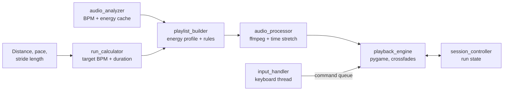

# Running Playlist Generator

Turns your own music library into a running mix. Give it a distance and pace and it picks songs that match your cadence, time-stretches them to the right tempo, and plays them back to back with crossfades, shaped to an energy curve across the run.

<!-- DEMO: drag your screen recording here in the GitHub web editor (see "Recording the demo" in my notes) -->

## Why I built it

I like running to DJ sets. A good set is one continuous mix where the tempo and energy carry you, and you never break stride waiting for the next song. Streaming apps can't do that with my own library, so I built a tool that can. It works out the tempo my feet are hitting, finds songs that fit, nudges them onto that tempo and mixes them together.

## What it does

- **Works out your target tempo** from pace and stride length (5:30 min/km is about 165 BPM)
- **Analyses your library** for BPM and energy with librosa, cached so each song is only analysed once
- **Picks the closest match** to the target BPM for each part of the run, using energy to choose between close candidates. Half-time tracks count too (an 82 BPM song still lands on every other step)
- **Time-stretches** each song onto the target tempo without changing its pitch, so a 156 BPM track plays at 165
- **Shapes the run** with calmer songs for the warmup and cooldown, and an energy profile in between: steady, build (finish strong) or pyramid (peak in the middle)
- **Plays it as a mix** with crossfades and live keyboard controls
- **Rotates your music** by skipping songs you've run to in the last 7 days, and only repeats a song if your library is too small to fill the run

## Quick start

You'll need macOS or Linux (the keyboard controls use Unix terminal APIs), Python 3.10 or newer (tested on 3.10 and 3.13), and ffmpeg.

```bash
brew install ffmpeg            # or your Linux package manager

git clone https://github.com/remcoah/running-playlist.git
cd running-playlist
python3.10 -m venv .venv       # any Python 3.10+ works; check with python3 --version
source .venv/bin/activate
pip install -r requirements.txt
```

**Add some music.** Copy audio files into `songs/`, or point the app at an existing folder with `--folder`. Supported formats: `.mp3`, `.flac`, `.wav`, `.m4a`, `.ogg`, `.aiff`.

**No music handy?** Generate a few royalty-free click tracks at running tempos:

```bash
python scripts/make_demo_songs.py
```

**Run it:**

```bash
python main.py --distance 5 --pace 5.5
```

The first run analyses your library, which takes a few seconds per song. After that it's cached. You'll see the playlist, choose a transition style and energy profile, then the app stretches the tracks and starts playing. The playlist is also saved to `results/playlist.m3u`, which opens in VLC or any M3U player.

To build and save a playlist without playing audio (handy on a machine without speakers):

```bash
python main.py --distance 5 --pace 5.5 --no-playback
```

### Controls

| Key | Action |
|---|---|
| `Space` | Pause / resume |
| `→` | Next track |
| `←` | Restart track (or previous track if within the first 3 seconds) |
| `↑` / `↓` | Volume |
| `Q` | Quit |

<details>
<summary><b>All command line options</b></summary>

| Option | Default | Description |
|---|---|---|
| `--distance` | required | Run distance in kilometres |
| `--pace` | required | Pace in minutes per kilometre |
| `--folder` | `songs/` | Path to your music folder |
| `--tolerance` | `15` | BPM tolerance around the target (wider means more songs are eligible) |
| `--format` | `m3u` | Saved playlist format: `m3u` or `json` |
| `--output` | `results/playlist` | Output path, without extension |
| `--rescan` | off | Re-analyse the whole library from scratch |
| `--no-playback` | off | Build and save the playlist without playing it |
| `--ignore-recent` | off | Include songs played in the last 7 days |
| `--clear-history` | off | Reset play history for every song |

**More examples:**

```bash
# 10 km using your own music folder
python main.py --distance 10 --pace 5.5 --folder ~/Music

# Half marathon with a wider BPM window, saved as JSON
python main.py --distance 21.1 --pace 6.0 --tolerance 20 --format json

# Re-analyse everything after adding new songs
python main.py --distance 5 --pace 5.0 --rescan
```

**Stride length** affects the target BPM. The default of 2.2 m suits most runners. To change it, edit `config/user_profile.json`:

```json
{
  "stride_length_m": 2.2
}
```

A shorter stride gives a higher target BPM at the same pace.

</details>

## How it works



A few rules hold the design together:

- **Each module owns one job.** Only `playback_engine` touches pygame, only `audio_analyzer` reads or writes the song cache, only `session_controller` holds run state, and only `main.py` prints. Everything else returns data, which keeps it testable.
- **One shape for every input.** Whatever the source of a run's details, it becomes a `RunContext`. That's so future inputs like Strava history or live heart rate can plug in without touching the playlist logic.
- **Threads talk through a queue.** The keyboard listener drops commands into a queue and the audio loop picks them up, so neither can block the other.
- **Nothing slow happens during playback.** Analysis, stretching and loading audio all happen before the first song plays. Any disk read inside the playback loop is audible as a stutter.

```
config/     Settings and user profile
core/       Run calculation, playlist building, rules, energy profiles, session state
music/      Library analysis, time stretching, temp file management
playback/   Audio engine and keyboard input
output/     Playlist and summary formatting
scripts/    Demo track generator
tests/      pytest suite
songs/      Your music (git-ignored)
results/    Saved playlists (git-ignored)
main.py     Command line entry point
```

## How I built it

I designed the system before writing code: the layers, what each module accepts and returns, and which module owns what. Then I built it in three phases (playlist generator, playback, time stretching), each adding to the last without rewriting it.

I talked through design options with Claude, and Claude Code wrote most of the implementation one module at a time. I made the design calls, reviewed every diff, ran the tests and used the app on real runs before moving on. The decisions I'm proudest of:

- **Stretching as a bridge, not the engine.** After hearing songs stretched by 20%, I changed selection to prefer songs already near the target BPM, so stretching only closes a small gap.
- **The `RunContext` abstraction**, so Strava or heart rate data can plug in later without touching the playlist logic.
- **Not calling anything done until I'd heard it.** Most bugs were found by listening on real runs, not by tests.

## Two bugs I learned from

**Crossfades broke after time-stretching, but only for sped-up songs.** Tracks kept their original length after stretching, so a song shortened from 302 to 277 seconds ended before the crossfade window opened. I found it by logging each step of a transition and testing sped-up and slowed-down songs separately, then fixed it by measuring the stretched audio. Lesson: when a change works in two directions, test both.

**A duplicate test class silently skipped 8 tests.** `TestApplyCommand` was defined twice, so Python kept only the second and pytest ran 1 of 9 tests while reporting everything as passing. `pytest --collect-only` confirmed it, and renaming the class brought the 8 tests back. They passed. Lesson: a passing count isn't proof, so check what's actually being collected.

## Tests

```bash
pip install -r requirements-dev.txt
python -m pytest
```

131 tests cover the BPM maths, playlist rules, song selection, time-stretching decisions, session state, keyboard handling and crossfade timing. Audio and hardware are mocked so the suite runs in under a second, and crossfade timing is tested with a fake clock that the tests move forward. What a stretched song actually sounds like is something I checked by ear.

## Limitations

- Tested on macOS. Linux should work, Windows won't (keyboard handling uses Unix terminal APIs)
- Keyboard controls need a real terminal, not an IDE output pane
- Songs more than about 20% away from the target BPM are played unstretched rather than distorted
- Playlists are only as good as the library: a library full of 120 BPM songs won't make a great 170 BPM run
- Stretched tracks are written to `temp/` as WAV files during a run (a few hundred MB for a long run) and deleted afterwards

## What's next

- Voice cues and interval training
- Strava integration to set pace from recent runs
- Live heart rate, adjusting tempo mid-run to keep you in your target zone
- A mobile app